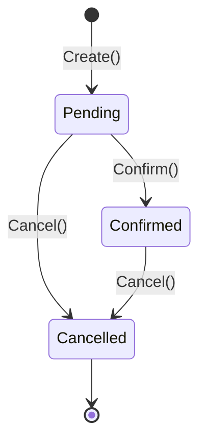
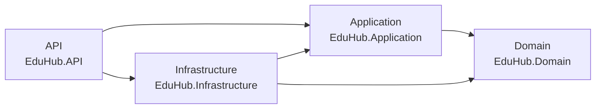

# Bài làm giữa kỳ IN4211 - EduHub

## Câu 1a

Bốn trụ cột của lập trình hướng đối tượng:

- **Đóng gói (Encapsulation):** giấu dữ liệu bên trong lớp, bên ngoài chỉ thay đổi qua các phương thức đã kiểm tra hợp lệ.
  Ví dụ: `EduHub.Domain/Entities/Registration.cs`, lớp `Registration` (setter `private`, trạng thái chỉ đổi qua `Confirm()` và `Cancel()`).
- **Kế thừa (Inheritance):** lớp con dùng lại code của lớp cha.
  Ví dụ: `EduHub.Infrastructure/Notifications/ConsoleNotificationServiceBase.cs`, lớp cha `ConsoleNotificationServiceBase`; `EmailNotificationService` và `SmsNotificationService` kế thừa từ lớp này.
- **Đa hình (Polymorphism):** cùng một lời gọi nhưng chạy khác nhau tuỳ đối tượng thực tế.
  Ví dụ: `EduHub.Application/Services/EventService.cs`, lớp `EventService` gọi `Send(...)` của `INotificationService`, tuỳ kênh mà chạy email hoặc SMS.
- **Trừu tượng (Abstraction):** chỉ nói "làm gì", giấu "làm như thế nào".
  Ví dụ: `EduHub.Application/Abstractions/IEventRepository.cs`, interface `IEventRepository`; `EventService` chỉ biết interface, không biết dữ liệu lưu ở đâu.

## Câu 1b

Hai vấn đề của lớp `Member` chưa đóng gói:

1. Các thuộc tính có `public set`, nên bên ngoài gán giá trị sai được, ví dụ `m.Email = "abc"` (không có `@`).
2. Constructor `public Member()` cho phép tạo đối tượng rỗng (`Email` là `null`), tức là đối tượng không hợp lệ.

Lớp đã viết lại: `EduHub.Domain/Entities/Member.cs`. Setter và constructor đều `private`, tạo đối tượng qua `Member.Create(email)`, hàm này kiểm tra email không rỗng và có ký tự `@`.

## Câu 2a



`Cancelled` là trạng thái cuối, không có mũi tên đi ra, nên phiếu đã huỷ không đổi được nữa.

## Câu 3a

Lớp `EventService` vi phạm 3 nguyên lý SOLID:

1. **SRP (mỗi lớp một nhiệm vụ), dòng 6-14:** một phương thức làm 4 việc: kiểm tra dữ liệu (dòng 6-7), lưu CSDL (dòng 8-9), ghi log (dòng 10), gửi thông báo (dòng 11-14).
2. **OCP (mở để mở rộng, đóng với sửa đổi), dòng 11-14:** `if/else if` theo `channel`, thêm kênh mới phải sửa lại lớp này.
3. **DIP (phụ thuộc vào interface, không phụ thuộc lớp cụ thể), dòng 8, 10, 12, 14:** dùng trực tiếp `new SqlConnection`, `File.AppendAllText`, `new EmailSender()`, `new SmsSender()`.

## Câu 4b

- **`git merge`:** gộp hai nhánh bằng một commit gộp, giữ nguyên lịch sử cũ.
- **`git rebase`:** đặt lại các commit của nhánh mình lên đầu nhánh đích, lịch sử thẳng và gọn hơn nhưng bị viết lại (commit đổi mã).

**Không nên dùng rebase** khi nhánh đã được push và người khác đang dùng chung (ví dụ `main`), vì lịch sử bị đổi sẽ gây xung đột cho người khác.

## Câu 5a

Lệnh thiết lập tham chiếu:

```bash
dotnet add EduHub.Application reference EduHub.Domain
dotnet add EduHub.Infrastructure reference EduHub.Application EduHub.Domain
dotnet add EduHub.API reference EduHub.Application EduHub.Infrastructure
dotnet add EduHub.Tests reference EduHub.Domain EduHub.Application
```

Sơ đồ bốn lớp (mũi tên chỉ chiều phụ thuộc):



| Thành phần | Nằm ở lớp |
|---|---|
| `Event` | Domain |
| `IEventRepository` | Application |
| `EventService` | Application |
| `InMemoryEventRepository` | Infrastructure |
| `EventsController` | API |

## Câu 5b

`EduHub.Domain` là phần lõi chứa luật nghiệp vụ, không được phụ thuộc vào phần bên ngoài. Nếu Domain tham chiếu tới Infrastructure thì:

1. Bị tham chiếu vòng (Infrastructure → Application → Domain → Infrastructure), .NET không cho biên dịch.
2. Vi phạm nguyên tắc của Clean Architecture: lõi ổn định lại phụ thuộc vào phần hay thay đổi (CSDL, dịch vụ ngoài).

## Câu 5d

**Nguyên nhân:** `AddScoped` tạo một repository mới cho mỗi request. Mỗi repository có `List<Event>` riêng và rỗng. Request POST thêm vào danh sách của nó rồi bị huỷ khi request kết thúc, nên request GET sau đó nhận danh sách mới, rỗng.

**Cách đăng ký để tránh lỗi** (trong `Program.cs`):

```csharp
builder.Services.AddSingleton<IEventRepository, InMemoryEventRepository>();
```

`AddSingleton` chỉ tạo một repository dùng chung cho toàn ứng dụng, nên dữ liệu được giữ giữa các request.
